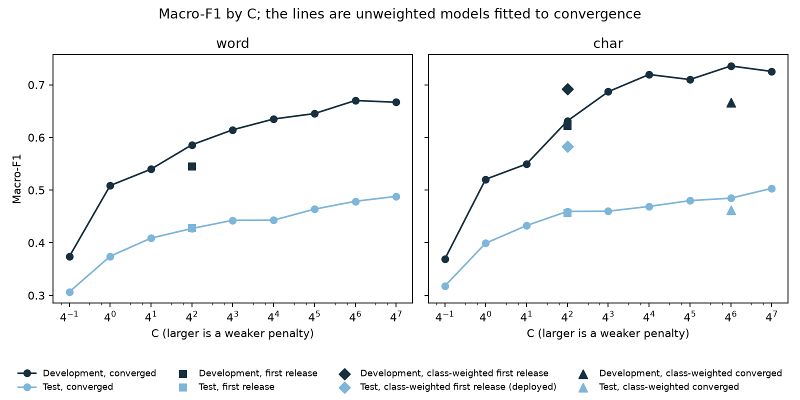

# Results and error analysis

[← README](../README.md)

## Scores

Development macro-F1 selects `char_balanced`. The test split was scored once, after that choice was written to `models/deployed.json`.

| System | Dev macro-F1 | Test accuracy | Test macro-P | Test macro-R | Test macro-F1 |
| --- | ---: | ---: | ---: | ---: | ---: |
| majority | 0.027 | 0.091 | 0.006 | 0.071 | 0.012 |
| word | 0.545 | 0.690 | 0.540 | 0.476 | 0.428 |
| char | 0.622 | 0.697 | 0.708 | 0.500 | 0.456 |
| char_balanced (deployed) | 0.692 | 0.734 | 0.648 | 0.594 | 0.583 |
| probe | 0.239 | 0.520 | 0.252 | 0.283 | 0.244 |
| full | 0.477 | 0.665 | 0.412 | 0.461 | 0.392 |
| full_weighted | 0.488 | 0.674 | 0.549 | 0.491 | 0.435 |

The cutoff is 0.5743. On development it files 80.1 percent of articles and 86.3 percent of those are correct. On test it files 73.8 percent, and 84.7 percent of those are correct.

[notebooks/04_evaluation.ipynb](../notebooks/04_evaluation.ipynb) writes these numbers to `results/metrics.json`. The per-article predictions for every system and split are in `results/*_dev.jsonl` and `results/*_test.jsonl`.

## Findings

Over half of the official training file is repeated text. 9,384 of its 17,014 rows are exact duplicates, some copied 40 or 80 times, and 156 of the repeated articles carry more than one section label. Notebook 01 removes them before any training ([data/README.md](../data/README.md)).

Character n-grams beat word n-grams, with development macro-F1 of 0.622 against 0.545. Kinyarwanda builds words from many prefixes and suffixes, and a character window can match the shared stem of two inflected forms that a whitespace split treats as different words.

Balanced class weights help the rare sections most. Development macro-F1 rises from 0.622 to 0.692 and test macro-F1 from 0.456 to 0.583. The weights cannot add articles to sections that have only 31 to 34 training examples. This holds for the saga fit that stops at 220 iterations; fitted to convergence with a weaker penalty, the weights no longer help on development ([below](#a-second-test-scoring)).

The frozen probe scores 0.239, so AfroXLMR-mini's pretraining alone does not separate the sections. Full fine-tuning (0.477) and class weights (0.488) close part of the gap and stay below the character model. The encoder sees only 128 tokens of a roughly 350-word article, and in all three encoder runs the development score was still rising at the third and last epoch (full: 0.383, 0.452, 0.477), so longer training and longer inputs are both open.

Every system drops from development to test because the test file has a different mix of sections ([data/README.md](../data/README.md#split-sizes)). The same shift is why the cutoff files fewer test articles (73.8 percent) than development articles (80.1 percent).

## A second test scoring

The saga solver behind the three linear systems stops at 220 iterations, and for `char_balanced` it stops there before converging. [notebooks/06_convergence.ipynb](../notebooks/06_convergence.ipynb) fits them to convergence with L-BFGS, which minimises the same regularised loss, over C from 0.25 to 16384 (a factor of 4 apart), and applies the development rules of notebooks 02 and 04. Every fit converged, in 52 to 142 iterations. The experiment scores the test split a second time.

| System | Fit | C | Dev macro-F1 | Test accuracy | Test macro-F1 | Mean top score on test |
| --- | --- | ---: | ---: | ---: | ---: | ---: |
| word | first release | 16 | 0.545 | 0.690 | 0.428 | 0.717 |
| word | converged | 4096 | 0.670 | 0.700 | 0.479 | 0.918 |
| char | first release | 16 | 0.622 | 0.697 | 0.456 | 0.740 |
| char | converged | 4096 | 0.736 | 0.683 | 0.485 | 0.915 |
| char_balanced | first release (deployed) | 16 | 0.692 | 0.734 | 0.583 | 0.743 |
| char_balanced | converged | 4096 | 0.666 | 0.683 | 0.462 | 0.910 |

On development the converged `char` at C = 4096 wins, with a cutoff of 0.9097. On test it would file 74.2 percent of articles and be right on 79.1 percent of those, against 73.8 and 84.7 percent for the deployed model.

The converged fits are not worse in general. With a weaker penalty, the unweighted word and character models gain on development and on test alike, and C = 4096 is the best development value for both.

The difference is the class-weighted model. The deployed `char_balanced` puts far more test articles under the small sections that the test file holds two to three times as many of as the training file, and the converged `char` almost stops filing environment and tourism:

| Section | Train | Test | Filed by deployed `char_balanced` | Filed by converged `char` | Recall, deployed → converged |
| --- | ---: | ---: | ---: | ---: | --- |
| environment | 34 | 100 | 64 | 9 | 0.46 → 0.08 |
| tourism | 31 | 76 | 26 | 7 | 0.25 → 0.08 |
| fashion | 34 | 91 | 86 | 35 | 0.55 → 0.35 |
| culture | 69 | 138 | 50 | 32 | 0.30 → 0.19 |

Those four sections account for most of the drop in test macro-F1 (F1 down 0.41 for environment, 0.23 for tourism, and 0.14 for culture). Development is a random tenth of the training file, so it keeps the training mix, with 3 to 8 articles in each of these sections, and cannot see that advantage. At C = 4096 the class weights lower development macro-F1 from 0.736 to 0.666, so the rule picks the unweighted model. The converged models are also far more certain: their mean top score on test is about 0.91 against about 0.74, and the cutoff the same rule picks rises from 0.5743 to 0.9097.

The deployed system stays `char_balanced`. That decision was made after both test scorings had been seen, so it is not a development-only choice: notebook 04's rule applied to the converged fits would deploy `char`. The Scores table above comes from the first scoring, made before this experiment. The lesson is that a development split drawn from the training file does not represent the test file's mix of sections, and a fair choice between these models would need development data with that mix or a selection rule that weighs the small sections accordingly. One seed and one early-stopped fit cannot show how much of the deployed model's advantage is chance.

## Error analysis

[notebooks/05_error_analysis.ipynb](../notebooks/05_error_analysis.ipynb) draws the figures below and writes `results/error_analysis.json`, which lists the top confusions, the confident mistakes, and the refusals.

Sport has the highest test F1 (0.94), followed by entertainment (0.81), relationship (0.80), religion (0.73), and technology (0.72).

Education is the weakest section at F1 0.07, and 38 of its 70 test articles are filed as relationship. History reaches 0.33 on 11 test articles. Tourism reaches 0.37 with recall 0.25 and is most often filed as economy, and culture reaches 0.45 with recall 0.30 and often goes to politics.

The most common confusions are health filed as politics (50), entertainment as politics (47), entertainment as health (40), culture as politics (39), education as relationship (38), and religion as politics (35). Politics is the largest training section and pulls in stories from many of its neighbours.

Many confident mistakes sit on the boundary between publisher sections. Beauty-pageant stories (Miss Supranational, Miss Universe) labelled entertainment are filed as fashion with a score near 1.00. Others come from label noise: football stories about APR FC, Rayon Sports, and the national team carry the entertainment label in the test file, and the model files them as sport. The 156 repeated training articles with more than one label show the same entertainment and sport confusion.

Correct filings get higher scores than wrong ones on average, but the two distributions overlap, so the cutoff holds back some correct filings along with the errors.
